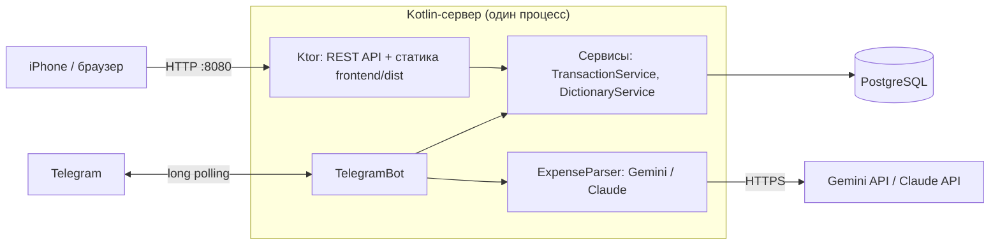

# Finances

Семейный трекер расходов и доходов с веб-интерфейсом и Telegram-ботом на базе ИИ.

Траты можно добавлять тремя способами:

- **через сайт** — форма с выбором категории, подкатегории и человека;
- **сообщением в Telegram** — `12.50 кофе`, `вчера 30 аптека`, `зарплата 4200`: ИИ сам определяет сумму, дату, валюту и категорию;
- **фото или PDF чека в Telegram** — ИИ читает чек, сохраняет одну трату на всю сумму и отдельно все позиции чека.

Приложение рассчитано на запуск дома (на своём компьютере или мини-сервере) и использование с телефона: сайт можно установить на iPhone как веб-приложение.

## Возможности

| Область | Что умеет |
|---|---|
| Учёт | Транзакции с датой, суммой, валютой, человеком, категорией, подкатегорией и комментарием. Расходы хранятся с минусом, доходы — с плюсом |
| Справочники | Категории, подкатегории и люди; новые категории и подкатегории можно создавать прямо из формы |
| Дашборд | Фильтр по месяцу и году, итоги (расходы / доходы / баланс), круговая диаграмма расходов по категориям (EUR) |
| Чеки | Позиции чека хранятся отдельно и раскрываются под общей строкой по кнопке «▸ N items» |
| Экспорт | Выгрузка транзакций за месяц в Excel (.xlsx) |
| Telegram-бот | Добавление трат текстом и по чеку, кнопка «Отменить», доступ только для разрешённых пользователей |
| ИИ | Gemini (по умолчанию, есть бесплатный тариф) или Claude — выбирается переменной окружения |
| Мобильный доступ | PWA-манифест и иконки: «На экран „Домой“» в Safari открывает сайт как приложение |

## Технологии

- **Backend:** Kotlin 1.9, Ktor 2.3 (Netty), JDBC + HikariCP, kotlinx.serialization, Apache POI
- **База данных:** PostgreSQL 16 (Docker)
- **Frontend:** React 18, TypeScript, Vite, React Router, Recharts
- **ИИ:** Gemini API (Interactions API, structured output) или Claude API (`anthropic-java`)
- **Telegram:** Bot API через long polling, без сторонних библиотек

## Архитектура



Подробнее — в [docs/architecture.md](docs/architecture.md).

## Быстрый старт

Нужны: JDK 17+, Node.js 18+, Docker.

```powershell
# 1. База данных
docker compose up -d
Get-Content db-script/init.sql -Raw | docker exec -i finances_db psql -U finances_user -d finances

# 2. Фронтенд (сборка в frontend/dist, его раздаёт сервер)
cd frontend; npm install; npm run build; cd ..

# 3. Сервер
.\gradlew.bat run
```

Сайт откроется на http://localhost:8080.

Чтобы включить Telegram-бота, задайте `TELEGRAM_BOT_TOKEN`, `GEMINI_API_KEY` и впишите свой Telegram id в `bot.properties` — пошагово в [docs/setup.md](docs/setup.md).

## Документация

| Раздел | О чём |
|---|---|
| [Установка и запуск](docs/setup.md) | Зависимости, переменные окружения, запуск, доступ с телефона, решение проблем |
| [Архитектура](docs/architecture.md) | Слои приложения, структура кода, ключевые решения |
| [База данных](docs/database.md) | Таблицы, связи, миграции |
| [REST API](docs/api.md) | Все эндпоинты с примерами |
| [Telegram-бот и ИИ](docs/telegram-bot.md) | Как бот разбирает сообщения и чеки, промпты, провайдеры ИИ |

## Безопасность

У сайта и API **нет авторизации** — они рассчитаны на домашнюю сеть. Не открывайте порт 8080 в интернет через проброс портов; для доступа вне дома используйте VPN вроде Tailscale. Токены (`TELEGRAM_BOT_TOKEN`, `GEMINI_API_KEY`, `ANTHROPIC_API_KEY`) храните только в переменных окружения и не коммитьте. Подробнее — в [docs/setup.md](docs/setup.md#безопасность).

## Планы

- Авторизация на сайте
- Редактирование позиций чека в интерфейсе
- Аналитика по позициям (например, сколько уходит на сладкое)
- Конвертация валют для итогов и диаграммы
- Голосовые сообщения в боте
