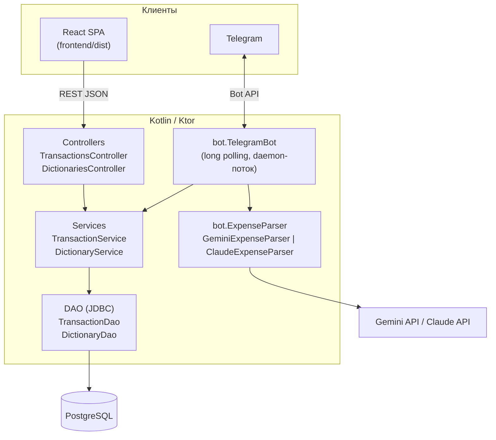

# Архитектура

Приложение — один Kotlin-процесс, который одновременно:

- отдаёт REST API (`/api/...`) и собранный React-фронтенд;
- в фоновом потоке опрашивает Telegram и обрабатывает сообщения бота.

Оба входа работают через одни и те же сервисы, поэтому проверка данных одинаковая для сайта и бота.



## Структура проекта

```
finances/
├── build.gradle.kts            # зависимости backend, shadowJar
├── docker-compose.yml          # PostgreSQL 16
├── bot.properties              # разрешённые пользователи Telegram
├── db-script/
│   ├── init.sql                          # схема + стартовые данные
│   ├── migrate_add_dictionaries.sql      # историческая миграция (текстовые категории → справочники)
│   └── migrate_add_transaction_items.sql # таблица позиций чека
├── src/main/kotlin/
│   ├── Server.kt               # точка входа: Ktor, маршруты, запуск бота
│   ├── Main.kt                 # консольная утилита: печать транзакций
│   ├── api/                    # DTO для JSON (kotlinx.serialization)
│   ├── controller/             # HTTP-маршруты
│   ├── service/                # бизнес-логика и валидация, экспорт в Excel
│   ├── dao/                    # SQL-запросы через JDBC
│   ├── db/Database.kt          # пул соединений HikariCP
│   ├── model/                  # доменные классы
│   └── bot/
│       ├── TelegramBot.kt          # обработка сообщений, фото, кнопок
│       ├── ExpenseParser.kt        # интерфейс, промпты, JSON-схемы
│       ├── GeminiExpenseParser.kt  # Gemini Interactions API (HTTP)
│       └── ClaudeExpenseParser.kt  # Claude через anthropic-java SDK
└── frontend/
    ├── index.html              # мета-теги PWA / iOS
    ├── public/                 # manifest.json, иконки
    └── src/
        ├── App.tsx             # маршруты: /, /add, /transactions/:id/edit
        ├── api.ts              # обёртки над REST API
        ├── types.ts            # типы ответов API
        ├── pages/              # Dashboard, AddTransaction, EditTransaction
        └── components/         # TransactionsTable, CategoryPieChart
```

## Слои backend

| Слой | Ответственность |
|---|---|
| `controller` | Разбор HTTP-параметров, коды ответов, преобразование моделей в DTO |
| `service` | Валидация (существование категории/подкатегории/человека, формат даты и суммы), нормализация (валюта в верхнем регистре, обрезка комментария), Excel-экспорт |
| `dao` | SQL. Каждый метод берёт соединение из пула; `insertWithItems` выполняет вставку траты и позиций в одной транзакции БД |
| `bot` | Telegram и ИИ. Пишет в базу только через `TransactionService` |

## Ключевые решения

**Суммы со знаком.** Расход хранится отрицательным числом, доход — положительным. ИИ всегда возвращает положительную сумму и флаг `isIncome`, знак ставит код.

**Чек = одна транзакция + позиции.** Чек сохраняется одной строкой в `transactions` (итог чека, общая категория, магазин в комментарии), а каждая позиция — в `transaction_items`. Отчёты и диаграмма работают с общими строками и не задваивают суммы; позиции подгружаются отдельным запросом только при раскрытии. Удаление траты удаляет позиции каскадно.

**Структурированный ответ ИИ.** Оба провайдера получают JSON Schema и обязаны вернуть ответ строго по ней (`understood`, `amount`, `categoryId`, ...). Список категорий с id подставляется в системный промпт при каждом запросе, поэтому новые категории сразу доступны боту. Полученные id дополнительно проверяются на сервере.

**Сменный провайдер ИИ.** `ExpenseParser` — интерфейс с двумя реализациями; общий промпт и схема лежат в `ExpensePrompt`. Выбор — переменной `AI_PROVIDER`.

**Telegram без библиотек.** Бот использует `java.net.http.HttpClient` и long polling (`getUpdates` с таймаутом 30 с). Это ~400 строк кода и ноль дополнительных зависимостей; webhook не нужен, поэтому серверу не требуется публичный адрес.

**Фронтенд раздаёт сам сервер.** Отдельного веб-сервера нет: Ktor отдаёт `frontend/dist` и возвращает `index.html` для маршрутов SPA (`/add`, `/transactions/{id}/edit`).
