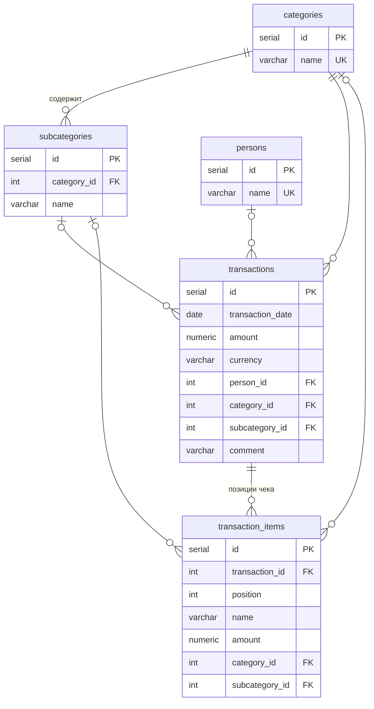

# База данных

PostgreSQL 16, база `finances`. Схема создаётся скриптом [`db-script/init.sql`](../db-script/init.sql).



## Таблицы

### `transactions`
Основная таблица: одна строка — одна трата, доход или чек целиком.

| Колонка | Тип | Описание |
|---|---|---|
| `id` | `SERIAL` | Первичный ключ |
| `transaction_date` | `DATE NOT NULL` | Дата операции |
| `amount` | `NUMERIC(12,2) NOT NULL` | Сумма: расход `< 0`, доход `> 0` |
| `currency` | `VARCHAR(3) NOT NULL`, по умолчанию `EUR` | Код валюты ISO 4217 |
| `person_id` | `INTEGER → persons` | Кто потратил (может быть пустым) |
| `category_id` | `INTEGER NOT NULL → categories` | Категория |
| `subcategory_id` | `INTEGER → subcategories` | Подкатегория, должна принадлежать категории (проверяется в сервисе) |
| `comment` | `VARCHAR(1000)` | Описание; для чеков — название магазина |

Индексы: по дате, категории, подкатегории, человеку.

### `transaction_items`
Позиции чека. Сумма позиций должна совпадать с `amount` родительской строки, но это не проверяется ограничениями — бот предупреждает о расхождении в ответе.

| Колонка | Тип | Описание |
|---|---|---|
| `id` | `SERIAL` | Первичный ключ |
| `transaction_id` | `INTEGER NOT NULL → transactions ON DELETE CASCADE` | Родительская транзакция |
| `position` | `INTEGER NOT NULL` | Порядковый номер строки в чеке, с 1 |
| `name` | `VARCHAR(500) NOT NULL` | Название позиции, например «Молоко 3.5% (Weihenstephan)» |
| `amount` | `NUMERIC(12,2) NOT NULL` | Сумма позиции, со знаком как у родителя |
| `category_id` | `INTEGER → categories` | Категория позиции (необязательно) |
| `subcategory_id` | `INTEGER → subcategories` | Подкатегория позиции (необязательно) |

### `categories`, `subcategories`, `persons`
Справочники. Имена категорий и людей уникальны; имя подкатегории уникально внутри категории (`UNIQUE (category_id, name)`).

Стартовые данные из `init.sql`:

- **Категории:** Income, Food, Transport, Housing, Utilities, Entertainment, Health, Subscriptions
- **Подкатегории:** Salary, Freelance, Groceries, Coffee, Public transport, Rent, Internet, Cinema, Pharmacy, Software
- **Люди:** Nikita, Natasha

Категории и подкатегории можно добавлять через сайт (форма добавления траты) или API.

## Миграции

Отдельного инструмента миграций нет — скрипты в `db-script/` применяются вручную через `psql`.

| Файл | Что делает |
|---|---|
| `init.sql` | Создаёт всю схему с нуля и заполняет справочники и примеры |
| `migrate_add_dictionaries.sql` | Историческая: переводила текстовые категории/людей в таблицы-справочники с id. Для новых установок не нужна |
| `migrate_add_transaction_items.sql` | Добавляет `transaction_items`. Нужна для баз, созданных до появления чеков; идемпотентна (`IF NOT EXISTS`) |

```powershell
Get-Content db-script/migrate_add_transaction_items.sql -Raw | docker exec -i finances_db psql -U finances_user -d finances
```

## Полезные запросы

```sql
-- Расходы по категориям за октябрь 2026 (EUR)
SELECT c.name, sum(t.amount) AS total
FROM transactions t JOIN categories c ON c.id = t.category_id
WHERE t.amount < 0 AND t.currency = 'EUR'
  AND t.transaction_date >= '2026-10-01' AND t.transaction_date < '2026-11-01'
GROUP BY c.name ORDER BY total;

-- Самые частые позиции в чеках
SELECT name, count(*), sum(amount)
FROM transaction_items
GROUP BY name ORDER BY count(*) DESC LIMIT 20;
```
