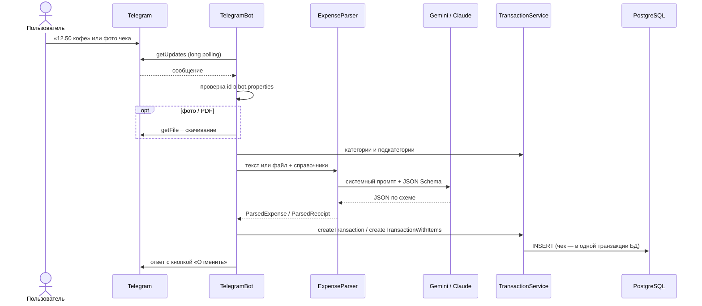

# Telegram-бот и ИИ

Бот запускается вместе с сервером, если задан `TELEGRAM_BOT_TOKEN`. Он работает через long polling, поэтому серверу не нужен публичный адрес — достаточно доступа в интернет. Настройка — в [setup.md](setup.md#настройка-telegram-бота).

## Что умеет

| Сообщение | Результат |
|---|---|
| `12.50 кофе` | Расход 12.50 EUR, Food / Coffee, сегодня |
| `вчера 30 аптека` | Расход 30 EUR, Health / Pharmacy, вчерашняя дата |
| `зарплата 4200` | Доход +4200 EUR, Income / Salary |
| `500 руб такси` | Расход 500 RUB |
| Фото или PDF чека | Одна трата на итог чека + все позиции в `transaction_items` |
| `/start`, `/help` | Справка |
| `/categories` | Список категорий и подкатегорий |

Под каждым ответом есть кнопка **«↩️ Отменить»** — она удаляет созданную транзакцию (для чека — вместе со всеми позициями).

Пример ответа на чек:

```
🧾 Чек добавлен
-25.89 EUR · Groceries
Kaufland
2026-10-10 · Nikita

Позиции (13):
• Вода Volvic Naturelle — 5.04
• Жвачка Wrigley Extra — 1.15
...
```

Чек принимается фотографией или файлом: JPEG, PNG, WebP, HEIC/HEIF, PDF (до 20 МБ — ограничение Telegram Bot API). В подписи к фото можно дать подсказку, например «вчера».

## Доступ

Писать боту могут только пользователи из `bot.properties` (формат `telegramId=Имя`) и переменной `TELEGRAM_USERS`. Имя связывает Telegram-аккаунт с записью в `persons` — так у каждой траты проставляется, кто её сделал. Незнакомому пользователю бот отвечает его id, чтобы его было легко добавить.

## Как обрабатывается сообщение



## Работа с ИИ

### Провайдеры

| | Gemini (по умолчанию) | Claude |
|---|---|---|
| Класс | `GeminiExpenseParser` | `ClaudeExpenseParser` |
| Модель по умолчанию | `gemini-3.5-flash-lite` | `claude-opus-5-5` |
| Как вызывается | HTTP к Gemini Interactions API | Официальный SDK `anthropic-java` |
| Стоимость | Бесплатный тариф с лимитами | Оплата за токены; `claude-haiku-5-5` — около $0.15 за 1000 трат |
| Рассуждения модели | `thinking_level`: `minimal` для текста, `low` для чеков | `effort`: `LOW` для текста, `MEDIUM` для чеков |
| Форматы чеков | JPEG, PNG, WebP, HEIC, PDF | JPEG, PNG, WebP, GIF, PDF |

Выбор провайдера — `AI_PROVIDER=gemini|claude`; модель — `GEMINI_MODEL` / `CLAUDE_MODEL`.

### Промпты и схемы

Промпты и JSON-схемы общие для обоих провайдеров и лежат в `ExpensePrompt` ([ExpenseParser.kt](../src/main/kotlin/bot/ExpenseParser.kt)). В системный промпт при каждом запросе подставляются:

- сегодняшняя дата — чтобы понимать «вчера», «в пятницу»;
- актуальный список категорий и подкатегорий с id из базы.

**Текстовое сообщение** → `ParsedExpense`:

| Поле | Смысл |
|---|---|
| `understood` | `false`, если в сообщении нет суммы или оно не о деньгах |
| `amount` | Всегда положительная сумма |
| `isIncome` | Доход или расход; знак ставит код |
| `currency` | ISO-код, по умолчанию EUR |
| `date` | `YYYY-MM-DD` |
| `categoryId`, `subcategoryId` | Только из переданного списка |
| `comment` | Короткое описание на языке пользователя |

**Чек** → `ParsedReceipt`: магазин, дата, валюта, итог, общая категория чека и массив позиций (`description`, `amount`, `categoryId`, `subcategoryId`). Правила разбора чека:

- одна запись на строку с товаром; служебные строки (налоги, оплата, сдача) пропускаются;
- сумма позиции — итог строки после скидок на эту строку;
- залог за бутылку (Pfand) прибавляется к напитку, возврат тары (Leergut) уменьшает соседнюю позицию;
- скидка на весь чек распределяется по позициям пропорционально;
- названия переводятся на русский с сохранением бренда.

### Проверки на стороне сервера

Ответу модели не доверяем вслепую:

- неизвестный `categoryId` у текстовой траты или у чека в целом — бот просит повторить;
- подкатегория, не принадлежащая категории, отбрасывается;
- у позиции чека неизвестная категория обнуляется, чек всё равно сохраняется;
- если сумма позиций не совпадает с итогом чека, в ответе появляется предупреждение. В транзакцию записывается итог чека — то, что реально списано.

## Ограничения

- Бот обрабатывает обновления последовательно в одном потоке: пока разбирается чек (несколько секунд), следующее сообщение ждёт.
- Список разрешённых пользователей читается при старте; после правки `bot.properties` нужен перезапуск.
- Позиции чека нельзя отредактировать в интерфейсе — только удалить чек целиком и отправить заново.
